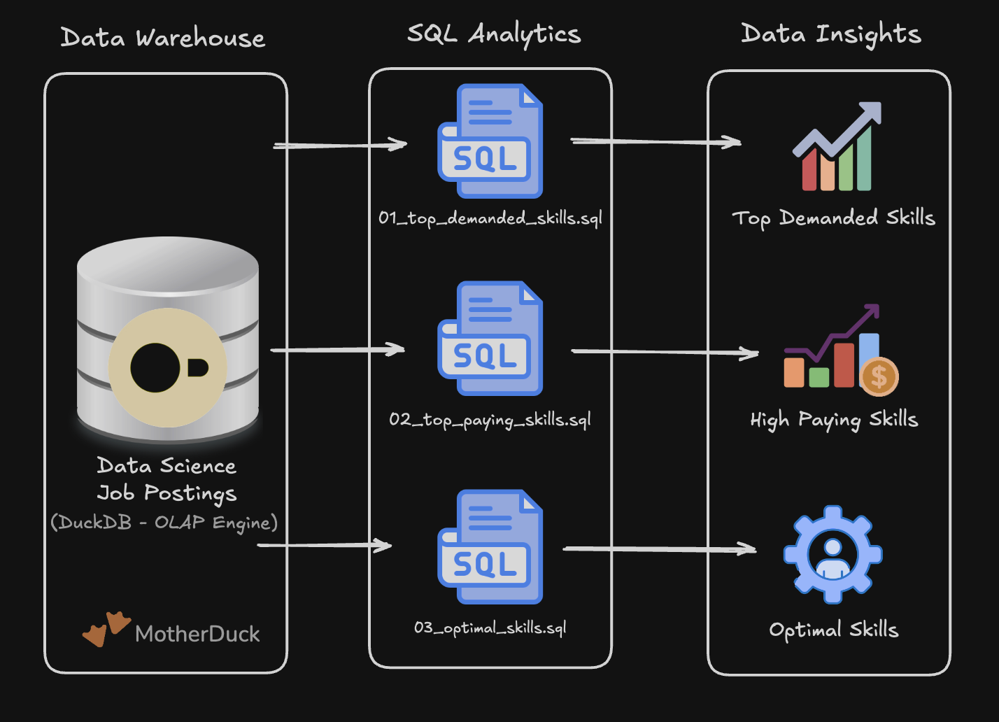

# HEADING 1

Normal text
**Bold  Text**.
*Italics Text*
`this is code`

- Bullet 1
- Bullet 2

1. number 1
2. number 2

[Link Text](https://google.com)


```sql
SELECT 
sd.skills,
COUNT(jpf.*) AS demand_count
FROM job_postings_fact AS jpf 
INNER JOIN Skills_job_dim AS sjd ON sjd.job_id = jpf.job_id
INNER JOIN skills_dim AS sd ON sjd.skill_id = sd.skill_id
WHERE
jpf.job_title_short = 'Data Engineer'
AND jpf.job_work_from_home = True
GROUP BY sd.skills
ORDER BY demand_count DESC
LIMIT 10;
 ```